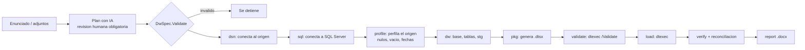
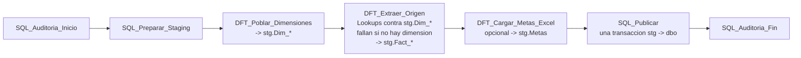

# Arquitectura

## Dentro del paquete SSIS

- **`src/Core`**: modelo (`Spec`), generadores (`DdlGenerator`, `SsisBuilder`, `Verification`), orquestacion (`Pipeline`), calidad (`Reconciliation`, `PackageInspector`), operacion (`AppLog`, `Notifier`, `Requirements`).
- **`src/UI`**: interfaz WPF; **`src/Program.cs`**: comandos de consola.
- Lo que no depende de SSIS ni de WPF se prueba en cualquier sistema con `tests/run.sh` (Mono).

## Politica de revision de la IA

El plan que propone la IA se valida por **formato** (`DwSpec.Validate`), no por significado. Antes de ejecutar, una persona debe revisar: la consulta de origen, las llaves de negocio, las medidas y columnas calculadas, y las dimensiones. El reporte `.docx` deja constancia de lo ejecutado.
